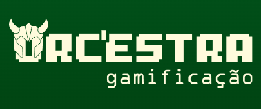
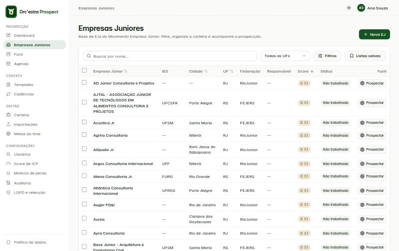
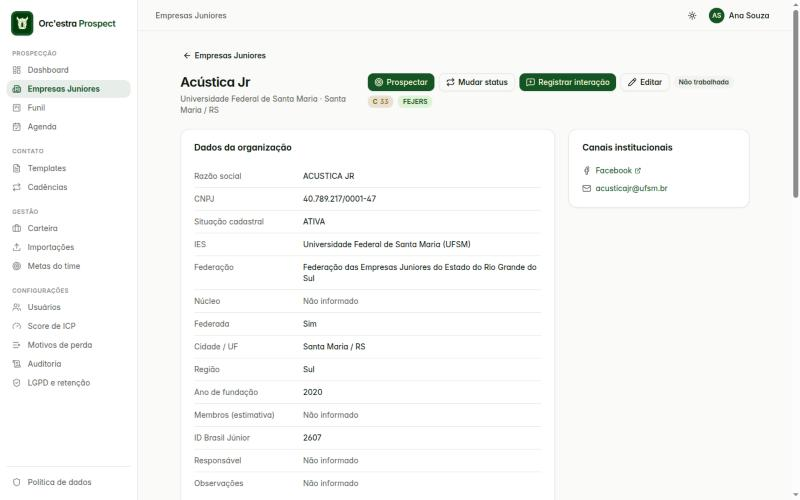
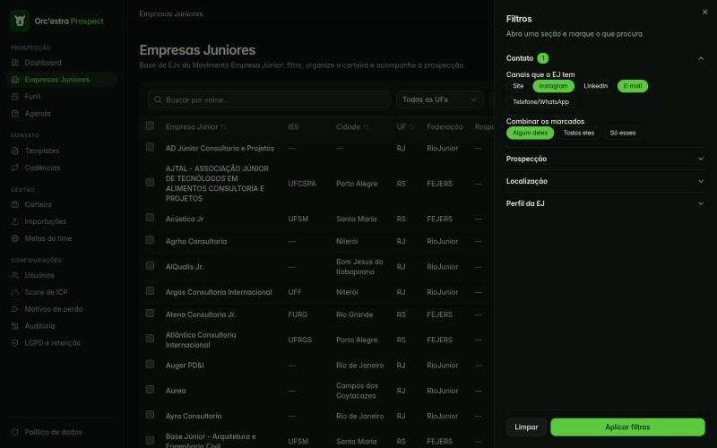
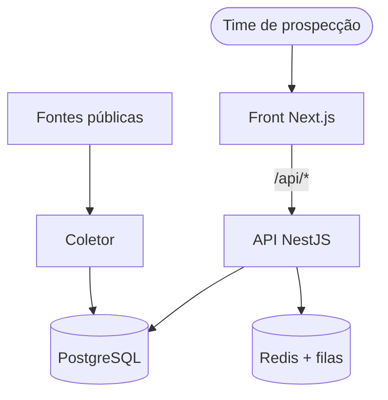

<div align="center">



### Prospecção de Empresas Juniores, do mapa ao primeiro contato

Plataforma de prospecção B2B da **Orc'estra Gamificação**, focada nas Empresas Juniores (EJs) do
Movimento Empresa Júnior. Junta uma base nacional de EJs, montada só com dados públicos, com um funil de vendas
simples de usar.

[](https://nextjs.org)
[](https://nestjs.com)
[](https://www.typescriptlang.org)
[](https://www.postgresql.org)
[](https://www.prisma.io)
[](docs/base-ejs.md)

[Funcionalidades](#-o-que-ele-faz) · [Telas](#-telas) · [A base de EJs](#-a-base-de-ejs) ·
[Como funciona](#-como-funciona) · [Rodar localmente](#-rodar-localmente) · [Documentação](#-documentação)

<br />



</div>

---

## 💡 Por que existe

Prospectar Empresas Juniores dava trabalho: as informações ficam espalhadas entre o site da Brasil Júnior,
27 federações, universidades e redes sociais, e o controle de quem já foi contatado acabava em planilhas.

O **Orc'estra Prospect** junta tudo num lugar só. Ele mostra quais EJs existem, como falar com cada uma e quais
valem mais a pena, e o time acompanha cada conversa até virar reunião.

<table>
  <tr>
    <td align="center"><h2>1.515</h2>EJs mapeadas</td>
    <td align="center"><h2>27/27</h2>estados cobertos</td>
    <td align="center"><h2>1.048</h2>com canal de contato público</td>
    <td align="center"><h2>0</h2>dados inventados</td>
  </tr>
</table>

## ✨ O que ele faz

| Recurso | Para quê |
| --- | --- |
| 🗺️ **Base nacional de EJs** | Nome, IES, cidade, federação, CNPJ e canais institucionais (site, Instagram, LinkedIn, e-mail, WhatsApp), cada um com fonte. |
| 🔎 **Filtros que fazem sentido** | Por canal de contato ("só tem e-mail", "tem site e LinkedIn"), região, UF, federação, status, faixa de ICP, área e mais. Os filtros ficam no link, então dá para compartilhar. |
| 🎯 **Prospectar num clique** | O botão **Prospectar** coloca a EJ na sua carteira e no funil. Se ela voltar para "Não trabalhada", fica livre para outra pessoa. |
| 📊 **Funil em kanban** | Arraste a EJ entre as etapas: primeiro contato, conversa, reunião, oportunidade, perdida ou nutrição. |
| 🧮 **Score de ICP** | Nota de 0 a 100 e faixa de A a D mostram quais EJs priorizar. Os pesos são ajustáveis. |
| 💬 **Cadências e templates** | Sequências de mensagens com tarefas na agenda. O sistema gera o texto e abre o WhatsApp ou o e-mail, mas **nada é enviado sozinho**. |
| 🏆 **Dashboard com gamificação** | Metas do time, ranking, conquistas, taxa de resposta por canal e cobertura por federação. |
| 🔐 **LGPD e auditoria** | Opt-out, lista de supressão, exportação e anonimização de contatos, e registro de toda ação relevante. |

## 🖼️ Telas

<table>
  <tr>
    <td width="50%"></td>
    <td width="50%"></td>
  </tr>
  <tr>
    <td align="center"><b>Página da EJ</b>: dados da organização, canais e ações do funil</td>
    <td align="center"><b>Filtros</b> em seções, aqui no tema escuro</td>
  </tr>
</table>

O layout é responsivo, com tema claro e escuro e as cores da marca Orc'estra.

## 🗂️ A base de EJs

A base é montada por um coletor próprio (`scripts/coleta`) que **só usa fontes públicas**:

- o cadastro nacional de EJs exposto pela FEJERS e as páginas das federações e universidades;
- **Receita Federal** (CNPJ e situação cadastral) e **IBGE** (municípios e regiões);
- verificação automática dos sites das EJs, de onde saem e-mail e WhatsApp **publicados pela própria EJ**;
- redes sociais confirmadas por busca, cada uma com o link da evidência.

Regras que não mudam: **nada é inventado** (campo sem fonte fica vazio), só entram **dados institucionais** e
EJs sem nenhum canal de contato ficam ocultas, sem ser apagadas. Detalhes em
[`docs/base-ejs.md`](docs/base-ejs.md); números atualizados em [`data/RELATORIO.md`](data/RELATORIO.md).

## ⚙️ Como funciona



- **Monorepo pnpm** com quatro pacotes: o front (`apps/web`), a API (`apps/api`), o compartilhado
  (`packages/shared`) e o coletor (`scripts/coleta`).
- Front e API **validam com os mesmos schemas Zod**, então uma regra muda num lugar só.
- O navegador só fala com o front, que repassa `/api/*` para a API. Não há CORS, e o cookie de sessão é `httpOnly`.
- Senhas usam argon2id, o login dura 15 minutos com refresh token rotativo, há rate limit e três papéis
  (ADMIN, GESTOR e SDR).

| Camada | Tecnologias |
| --- | --- |
| Front | Next.js 15 (App Router), Tailwind CSS 4, shadcn/ui, TanStack Query e Table, React Hook Form |
| API | NestJS 11, Prisma 6, PostgreSQL 16, Redis 7 + BullMQ, Swagger |
| Testes | Vitest, Jest (mais de 150 testes na API), Playwright (E2E) |
| Deploy | Render (front e API num único serviço) e Neon (Postgres) |

## 🚀 Rodar localmente

Requer Node 20+, pnpm 9 e Docker.

```bash
git clone https://github.com/VinyCrz/orcestra-prospect.git
cd orcestra-prospect
cp .env.example .env              # defina JWT_ACCESS_SECRET e ADMIN_SENHA
pnpm install
docker compose up -d postgres redis
pnpm db:migrate && pnpm db:seed   # cria o ADMIN e carrega a base de EJs
pnpm dev                          # web em http://localhost:3000 · API em :3001 (Swagger em /docs)
```

Para subir tudo em Docker, ver as variáveis de ambiente ou rodar os testes, consulte o
[guia técnico](docs/guia-tecnico.md).

## 📚 Documentação

| Documento | Conteúdo |
| --- | --- |
| [Guia técnico](docs/guia-tecnico.md) | scripts, autenticação, variáveis, papéis, LGPD, backup, testes e design |
| [Comandos](docs/comandos.md) | todos os comandos (Docker, banco, testes, E2E) |
| [Arquitetura](docs/arquitetura.md) | auth, proxy, banco e decisões técnicas |
| [Base de EJs](docs/base-ejs.md) | coletor, fontes, verificação dos sites e LGPD da base |
| [Decisões](docs/decisoes.md) | decisões de produto tomadas em cada etapa |
| [Deploy](docs/deploy.md) | como publicar de graça no Render e no Neon |
| [Paleta](brand/paleta.md) | cores e logo da marca |

<div align="center">
<br />
<sub>Feito para a <b>Orc'estra Gamificação</b> · uso interno · dados públicos e institucionais, tratados conforme a LGPD</sub>
</div>
